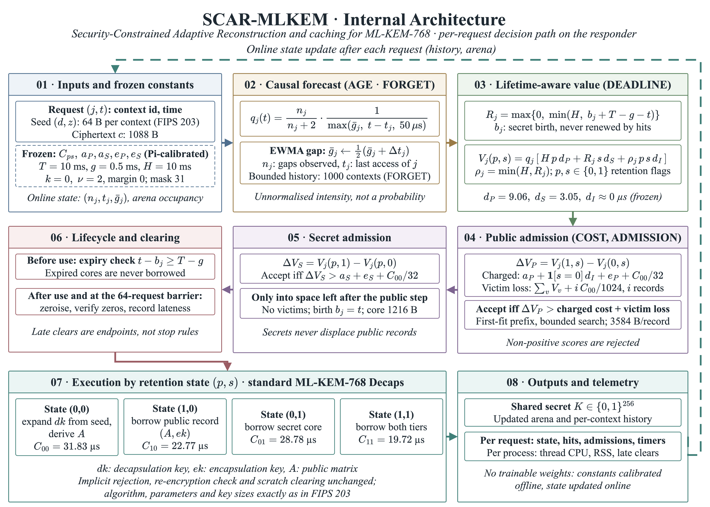
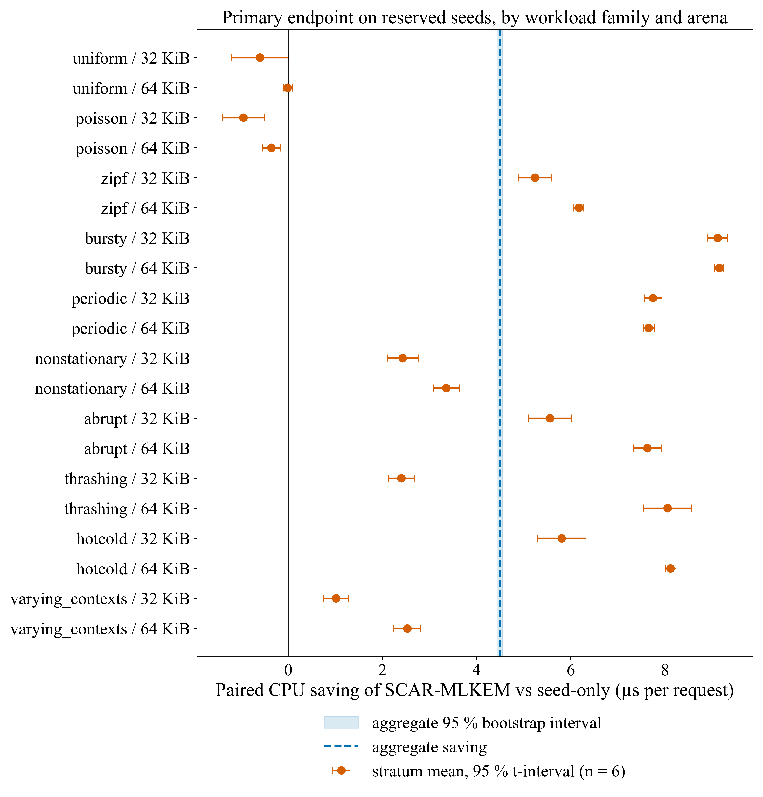
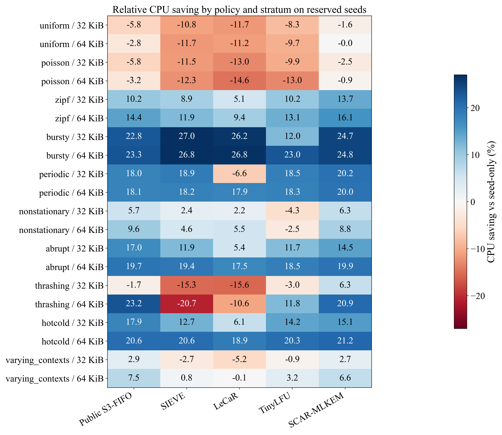
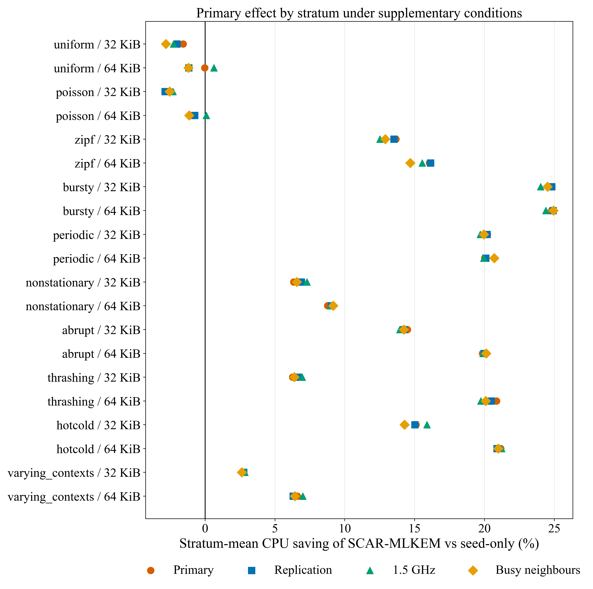
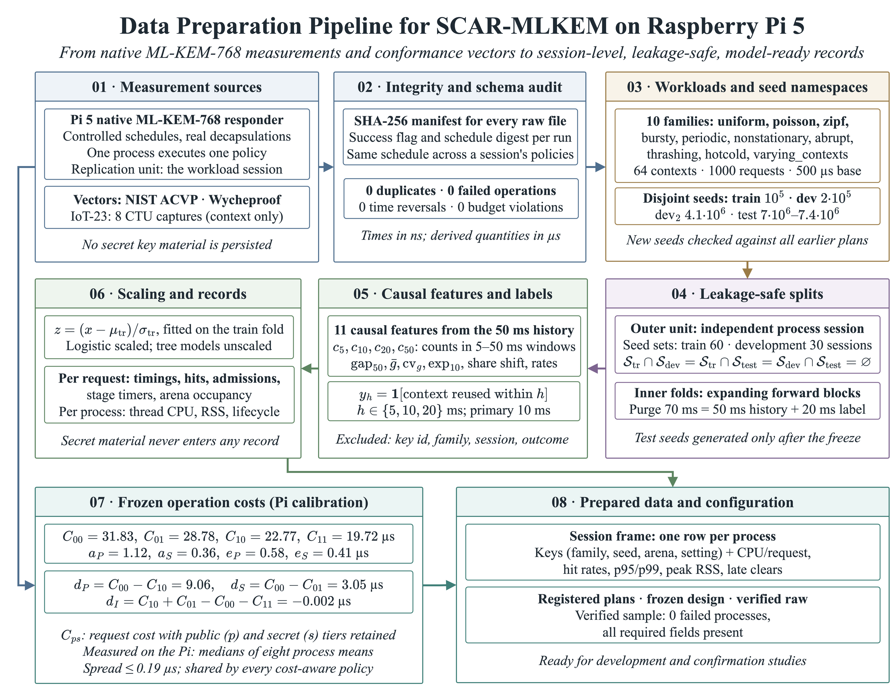

# SCAR-MLKEM

**Security-Constrained Adaptive Reconstruction and caching for ML-KEM-768 on a constrained device**

SCAR-MLKEM is a bounded, cost-aware controller that decides, per request, whether an ML-KEM-768 responder keeps the public record and the expanded secret core of a recently used key context, or reconstructs them from the 64-byte seed as the standard implementation does. The algorithm, its parameters and its key sizes are exactly those of FIPS 203; the controller only changes *what is retained for how long* under an explicit memory budget and a hard secret-lifetime limit. Every number in this repository was measured with native ML-KEM-768 decapsulations on a Raspberry Pi 5 (ARMv8.2, mlkem-native backend); the analysis runs in six Jupyter notebooks whose saved outputs are included.

<p align="center">
  
</p>

## Main result

On 120 reserved workload sessions (10 workload families × 2 memory budgets × 6 seeds that were never used before the method was frozen), the frozen controller lowers the complete request-phase CPU cost of ML-KEM-768 decapsulation relative to standard seed-only reconstruction, while remaining below four strong fixed cache policies run on the same schedules, the same core and the same cryptographic backend.

| Primary endpoint (paired within session, equal-stratum means) | Value |
|---|---|
| Seed-only reconstruction, complete CPU per request | 38.18 µs |
| SCAR-MLKEM, complete CPU per request | 33.67 µs |
| Absolute saving (95 % stratified bootstrap interval) | 4.50 µs [4.45; 4.55] |
| Relative saving (95 % interval) | **11.79 %** [11.67; 11.92] |
| One-sided 95 % lower bound | 11.69 % |
| Strata / sessions with a positive saving | 16 of 20 / 99 of 120 |
| Sustainable throughput on the pinned core | 26 194 → 29 696 requests per CPU-second (+13.4 %) |

| Secondary comparison (Holm-adjusted, one-sided paired t, n = 120) | Competitor CPU (µs) | SCAR-MLKEM saving | 95 % interval | Adjusted p |
|---|---:|---:|---|---:|
| vs public S3-FIFO | 34.15 | 1.40 % | [1.26; 1.53] | 3.2 × 10⁻⁷ |
| vs SIEVE | 36.31 | 7.27 % | [7.16; 7.38] | 2.9 × 10⁻¹² |
| vs LeCaR | 37.21 | 9.50 % | [9.39; 9.61] | 1.8 × 10⁻²¹ |
| vs TinyLFU | 35.84 | 6.04 % | [5.86; 6.22] | 1.3 × 10⁻²⁸ |

<p align="center">
  
</p>

The saving is concentrated where contexts recur inside the arena (bursty, periodic, hot-cold, abrupt and Zipf traffic: 14–25 %), smaller in nonstationary, thrashing and varying-context traffic (5–14 %), and negative in uniform and Poisson traffic (−0.8 % and −1.7 %), where recurrence inside a 64-context working set is too sparse to repay admissions. SCAR-MLKEM is the only policy that avoids large losses in every regime: public S3-FIFO loses 3–6 % in the sparse regimes, SCAR-MLKEM at most 2.5 %.

<p align="center">
  
</p>

## Side conditions preserved

| Quantity (120 reserved sessions per policy) | Seed-only | S3-FIFO | SIEVE | LeCaR | TinyLFU | **SCAR-MLKEM** |
|---|---:|---:|---:|---:|---:|---:|
| p95 response ratio vs seed-only (median) | 1.000 | 1.044 | 1.069 | 1.065 | 1.064 | **1.020** |
| p99 response ratio vs seed-only (median) | 1.000 | 1.052 | 1.073 | 1.067 | 1.081 | **1.049** |
| Peak RSS (MiB) | 21.82 | 21.83 | 21.85 | 21.87 | 21.88 | 21.89 |
| Policy metadata (bytes) | 0 | 624 | 32 | 2 496 | 1 184 | 1 824 |
| Controller decision work per request (µs) | 0.07 | 0.47 | 1.12 | 0.84 | 1.93 | **0.47** |
| Secret-core hit rate (%) | 0 | 0 | 36.3 | 45.0 | 40.1 | 32.7 |
| Checked zeroizations per session | 0 | 0 | 634 | 545 | 367 | 169 |
| Maximum secret residency (ms, limit 10 ms) | – | – | 9.60 | 10.02 | 10.57 | **9.90** |
| Late secret clears (sessions affected) | 0 | 0 | 0 | 1 (1) | 3 (2) | **0 (0)** |

Two one-sided tests establish equivalence of SCAR-MLKEM and seed-only reconstruction in peak RSS within ±2 % (geometric mean ratio 1.003, p = 5 × 10⁻⁴⁵) and in p95 response within ±5 % (ratio 1.013, p = 5 × 10⁻¹³). All 720 000 decapsulations of the confirmation returned the correct shared secret; the board stayed between 49.6 and 52.9 °C without throttling.

## Robustness on the same board

| Condition (frozen method, same worker) | Sessions | Seed-only → SCAR-MLKEM (µs) | Saving vs seed-only | 95 % interval | Saving vs S3-FIFO |
|---|---:|---|---:|---|---:|
| Primary confirmation (2.4 GHz, `performance` governor) | 120 | 38.18 → 33.67 | 11.79 % | [11.67; 11.92] | 1.40 % |
| Replication on a second set of 60 reserved seeds | 120 | 38.20 → 33.72 | 11.73 % | [11.57; 11.88] | 1.25 % |
| Pinned 1.5 GHz (`userspace` governor) | 40 | 60.81 → 53.65 | 11.76 % | [11.62; 11.91] | 1.73 % |
| Busy loops saturating the three other cores | 40 | 38.15 → 33.75 | 11.52 % | [11.34; 11.69] | 1.11 % |

Late secret clears are an operating-system property, not a property of the cache: with saturated neighbouring cores every secret-retaining policy records late clears (SCAR-MLKEM 10 in 3 of 40 sessions, maximum lateness 3.35 ms; LeCaR 15, 4.6 ms) and p99 response rises to 140–160 µs; under `SCHED_FIFO` priority 10 the same four policies record no late clear in 160 sessions and their p99 falls to 46–50 µs. The frozen cost model that drives the controller predicts the measured per-session saving with Pearson r = 0.993 (slope 1.06, intercept −2.05 µs). The aggregate is identical under equal-stratum, pooled-session and equal-family weighting (11.79 %); the median session saves 13.7 %.

<p align="center">
  
</p>

## What the development stage established

* **Frozen operation costs** (eight calibration processes, 57 600 decapsulations, spread ≤ 0.19 µs): C₀₀ = 31.83, C₁₀ = 22.77, C₀₁ = 28.78, C₁₁ = 19.72 µs; public admission 1.12 µs, secret admission 0.36 µs, checked erasure 0.58 / 0.41 µs. A retained public record saves 9.06 µs per hit, a retained secret core a further 3.05 µs, and the interaction term is −0.002 µs.
* **Development series** (900 processes, three fresh seeds per stratum): SCAR-MLKEM 11.56 % [11.47; 11.64] against seed-only, public S3-FIFO 10.47 %, TinyLFU 6.04 %, SIEVE 4.56 %, LeCaR 2.32 %. The confirmation reproduced this estimate within 0.3 percentage points.
* **Component ablations** (paired effect of each component, µs per request, bootstrap 95 % interval): COST 2.20 [2.11; 2.29], AGE 1.78 [1.68; 1.88], DEADLINE 0.84 [0.81; 0.88], ADMISSION 0.16 [0.13; 0.20], FORGET 0.04 [0.01; 0.06]. No component met the prespecified removal rule, so the full composition (mask 31) was frozen.
* **Secret-retention ceiling**: an exact paid-lease optimisation over the recorded request traces shows that *no* secret-retention rule can add more than 4.37 % of CPU over a public S3-FIFO cache at the 10 ms lifetime under the 64-request clearing barrier (5.27 % barrier-capped at 50 ms, 7.84 % only if the barrier is removed at 100 ms). This bounds the adaptive increment over a strong public cache and explains why it is small by construction.
* **Lifetime sensitivity**: raising the secret lifetime to 20 and 50 ms increases the saving to 12.17 % and 12.83 %; the limit stays frozen at 10 ms because a longer limit changes the security posture rather than the algorithm.
* **Offline optimum**: against Belady's clairvoyant MIN with the same arena capacity, SCAR-MLKEM is within 1–8 percentage points of the optimal public hit rate in recurring traffic at 64 KiB and 19–36 points below it in uniform, Poisson, nonstationary and varying-context traffic, which locates the remaining headroom for any causal policy.

## Method in brief

For context *j* with *nⱼ* completed gaps, last access *tⱼ* and EWMA gap *ḡⱼ*, the controller forecasts an unnormalised reuse intensity

$$q_j(t)=\frac{n_j}{n_j+2}\cdot\frac{1}{\max(\bar g_j,\;t-t_j,\;50\,\mu s)}$$

and values a retention state (*p* public record, *s* secret core) over the horizon *H* and the remaining secret window *Rⱼ = max(0, min(H, bⱼ + T − g − t))*:

$$V_j(p,s)=q_j\bigl(H\,p\,d_P+R_j\,s\,d_S+\min(H,R_j)\,p\,s\,d_I\bigr),\qquad d_P=C_{00}-C_{10},\; d_S=C_{00}-C_{01},\; d_I=C_{10}+C_{01}-C_{00}-C_{11}.$$

A public record is admitted only when its value gain exceeds the measured admission and erasure costs, a fixed engineering penalty *C₀₀/32* and the value of every displaced victim; a secret core is admitted only into the space left by that decision and must repay its own admission and erasure. Retained secrets are checked against the lifetime *T* = 10 ms (guard *g* = 500 µs) before every use, cleared after use when expired, and unconditionally zeroised at a 64-request barrier. Five components form the method and were ablated individually: AGE, FORGET, COST, DEADLINE and ADMISSION. The controller has no trainable weights: its constants are calibrated offline on the board and its state is updated online.

## Experimental design

| Element | Value |
|---|---|
| Device and backend | Raspberry Pi 5, process pinned to core 2, mlkem-native ARMv8.2 ML-KEM-768 |
| Observation / replication unit | one decapsulation request / one native process session (family, seed, arena) |
| Workload families | uniform, Poisson, Zipf, bursty, periodic, nonstationary, abrupt, thrashing, hot-cold, varying contexts |
| Session | 64 contexts, 1 000 requests, 500 µs base interval, fresh seeds and encapsulation randomness from the OS CSPRNG |
| Memory budgets | 32 KiB and 64 KiB locked arenas (8 and 17 public records) |
| Policies | seed-only reconstruction, public S3-FIFO, SIEVE, LeCaR, TinyLFU, SCAR-MLKEM, all with the same 10 ms secret lifetime |
| Seed namespaces | training 10⁵, development 2·10⁵ and 4.1·10⁶, reserved test 7.0·10⁶–7.4·10⁶; every new plan is checked against all earlier plans |
| Primary endpoint | complete request-phase thread CPU per request, paired within session against seed-only reconstruction |
| Inference | equal-stratum means; stratified percentile bootstrap over sessions within strata (10 000 resamples); one-sided paired t-tests with Holm adjustment for the four secondary comparisons; TOST for equivalence |
| Prespecification | the design, competitor set, endpoints and inference rules were frozen and the confirmation plan was written before any reserved seed was generated |

<p align="center">
  
</p>

## Repository layout

```
notebooks/   six notebooks with their saved outputs (run in numerical order)
dataset/     raw Raspberry Pi measurements, derived tables and splits used by the notebooks
artifacts/   result tables (CSV) produced by the notebooks
figures/     main figures 1–9 and supplementary figures S1–S34 (PNG 350 dpi and vector PDF)
support/     configurations, campaign plans, hash manifests, native C sources, calibration records and fitted models
```

| Notebook | Content |
|---|---|
| `01_dataset_analysis_and_research_design` | provenance and integrity of the sources, observation schema, exploratory analysis of the ten workload families, feasibility pilot, evaluation contract |
| `02_feature_analysis_and_leakage_safe_preprocessing` | eleven causal history features, future-only labels, adversarial causality checks, purged forward folds |
| `03_baseline_models_and_error_diagnostics` | statistical and logistic predictors, native parity checks, seven baseline cache policies measured on the board |
| `04_modern_models_and_comparative_diagnostics` | random forest and gradient boosting, exact C export, TinyLFU, LeCaR and adaptive-TTL comparators |
| `05_proposed_model_development_and_ablations` | SCAR-MLKEM mechanism, frozen costs, secret-retention ceiling, 900-process development series, ablations, lifetime sensitivity, frozen design |
| `06_frozen_evaluation_statistics_and_publication_results` | prespecified protocol, 720-process confirmation, primary and secondary inference, tails, memory, lifecycle, efficiency, robustness, supplementary campaigns, Belady bound, seed sufficiency, cost-model calibration |

## Reproducing the analysis

```bash
git clone --depth 1 <repository-url>
cd <repository>
python -m venv .venv && source .venv/bin/activate
pip install -r requirements.txt
jupyter lab notebooks/
```

* Python 3.11 with the pinned package versions in `requirements.txt`; Times New Roman is used for the figures and any serif font is substituted when it is not installed.
* Every notebook verifies the SHA-256 digests of its inputs before using them and recomputes all statistics, tables and figures from the shipped data; no cell needs the board. Cells that talk to the Raspberry Pi are skipped unless an SSH setup folder is provided through `PI_SETUP_DIR` (it must contain `ssh_config` for the alias `nazira-pi`); a completed campaign is never re-acquired, so even with a board the saved measurements are only verified.
* The IoT-23 network logs used as external context in notebook 01 are not redistributed because the upstream licence notices conflict; `dataset/README.md` lists the eight files and their URLs, and the notebook skips that section when they are absent.
* The native sources of the SCAR-MLKEM harness and of the baseline harnesses are in `support/native/`; the build scripts target the Raspberry Pi 5 with the pinned mlkem-native revision recorded in `support/native/Development/core_controller/source_manifest.json`.

The raw measurements occupy about 750 MB on disk (3 190 native processes with per-request traces); a shallow clone is recommended.

## Figure index

| File | Content | Notebook |
|---|---|---|
| `1_scar_mlkem_architecture` | internal architecture and per-request decision path | – |
| `2_experimental_pipeline` | data preparation pipeline from native measurements to session records | – |
| `3_primary_endpoint_forest` | per-stratum paired saving against seed-only reconstruction with t-intervals | 06 |
| `4_regime_matrix` | relative CPU of every policy against seed-only per stratum | 06 |
| `5_response_tails` | distribution of per-session p99 response by policy | 06 |
| `6_secret_residency_ecdf` | empirical distribution of the maximum secret residency per session | 06 |
| `7_robustness_conditions` | per-stratum saving under replication, 1.5 GHz and busy neighbours | 06 |
| `8_secret_retention_ceiling` | paid-lease ceiling of secret retention against the lifetime limit | 05 |
| `9_lifetime_sensitivity` | saving and secret hit rate at 10, 20 and 50 ms lifetimes | 05 |
| `S1`–`S5` | reuse by workload, interarrival distributions, context recurrence, scheduled rate, pilot costs | 01 |
| `S6`–`S11` | marginal information, feature rank correlations, association stability, purged folds | 02 |
| `S12`–`S19` | baseline prediction error, calibration, confusion, native microbenchmarks, amortized work, hit, work and p99 matrices | 03 |
| `S20`–`S31` | modern predictors, calibration, error complementarity, regime errors, native overhead, hit and work matrices, key residency, shift hit rates | 04 |
| `S32`–`S33` | retention structure of the 40-process screen and of the development series | 05 |
| `S34` | seed sufficiency and cost-model calibration | 06 |

## Scope and limitations

The results describe one board, one software stack and controlled synthetic request schedules rather than production key-access traces; the comparators are the project's own bounded-TTL adaptations of published policies. The adaptive increment over the best fixed public cache is 1.1–1.7 % across conditions and is bounded by the secret-retention ceiling; uniform and Poisson traffic lose up to 2.5 % and should run with retention disabled. CPU time is not energy: no electrical measurement exists. Lifetime discipline under the default Linux scheduler is an operating-system property that a deployment must address by scheduling policy. Seed representation and expanded-key caching are established techniques; the contribution is the bounded, cost-charged, lifetime-aware controller and its measured evaluation.
